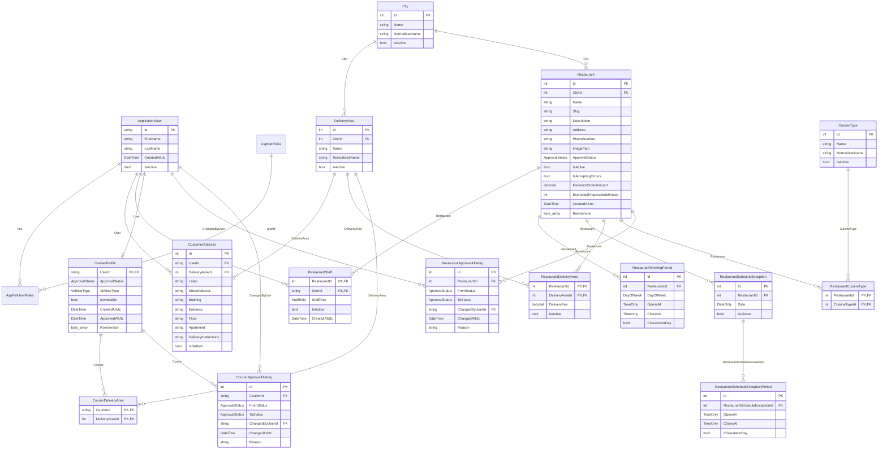
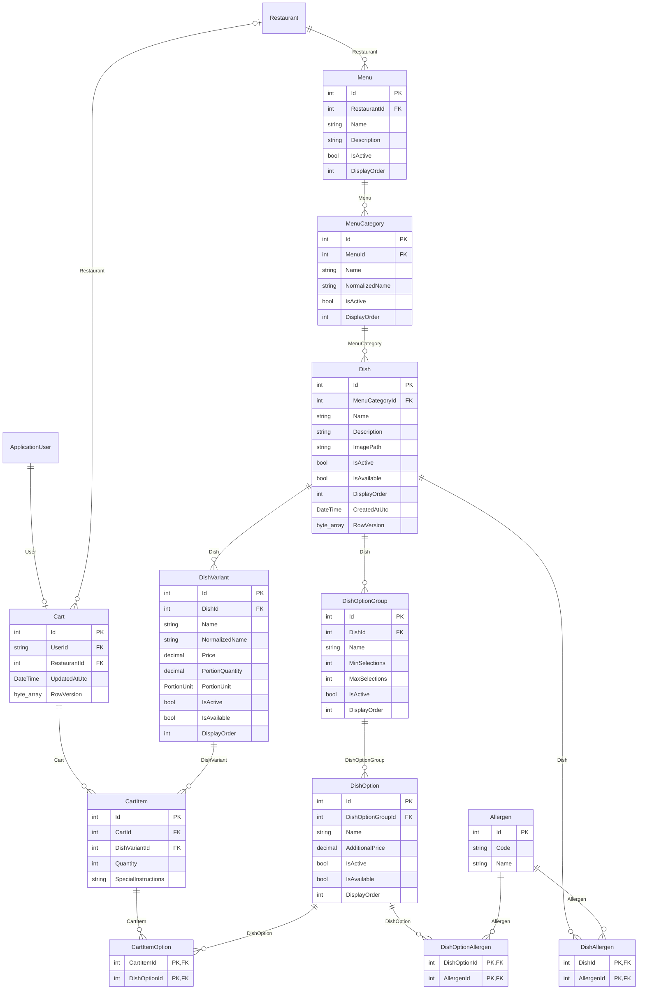
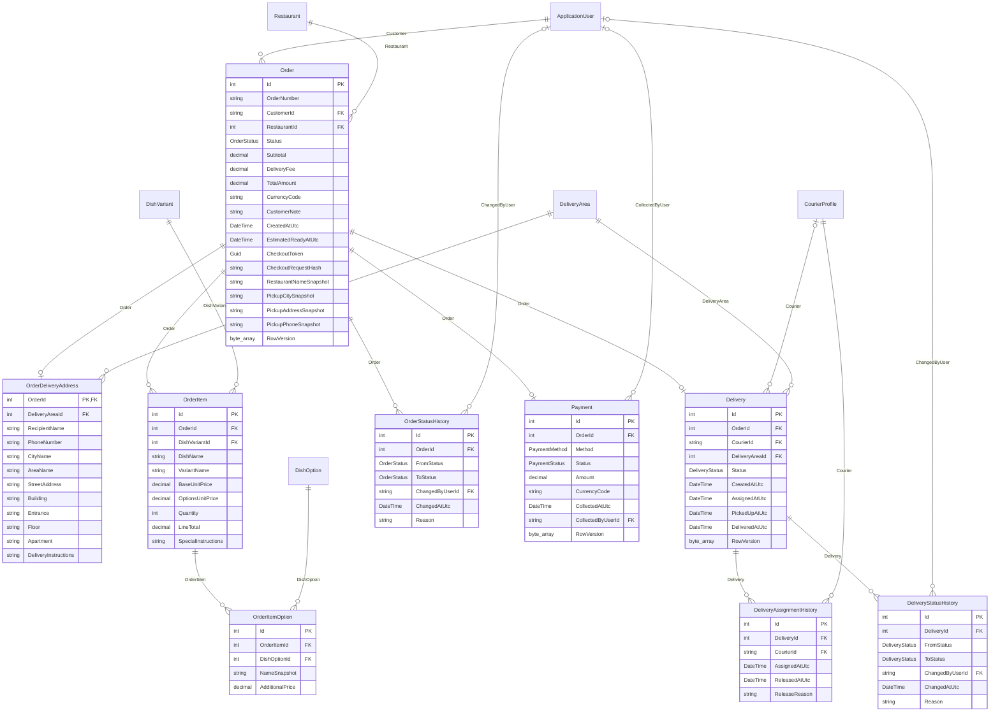
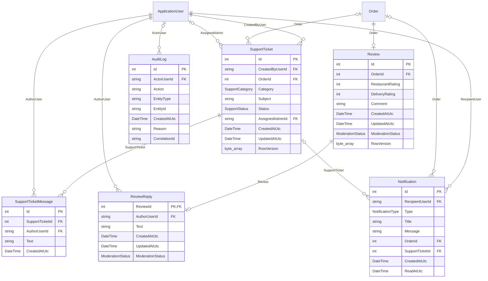

# ER диаграми

> **Диаграми на действителната текуща схема.** Опростяването от 16.11.2026 г. още не е приложено. Menu, варианти, staff и останалите показани таблици продължават да съществуват в кода/миграциите; присъствието им не ги прави задължителни за новата начална версия. Вижте [плана за промени](database-change-plan.md) и [новата спецификация](project-specification.md). Mermaid диаграмите не са подменени с бъдеща схема.

Групирани по области; външните за областта таблици са показани само като връзки.
ApplicationUser е AspNetUsers, останалите имена съвпадат с SQL таблиците.
Точните FK, nullable, checks и NO ACTION са в [database.md](database.md).

## Потребители, география и ресторанти

## Меню и количка

## Поръчки, плащания и доставки

## Отзиви, поддръжка и известия

